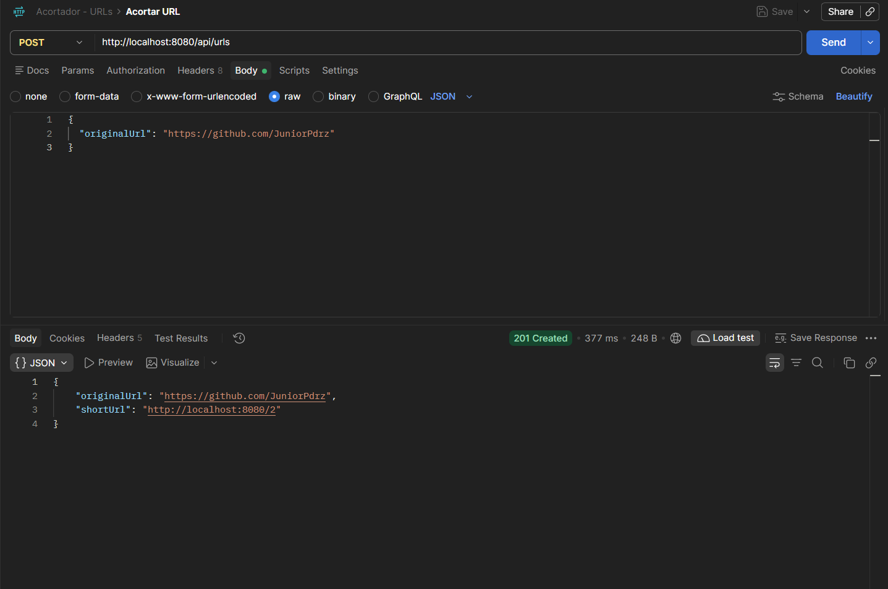

# Acortador de URLs

Aplicación web y API REST que convierte enlaces largos en códigos cortos y redirige al enlace original.

## Funcionalidades

- Acortar una URL desde un formulario web (Thymeleaf) o desde la API REST
- Redirección HTTP 302 desde el código corto a la URL original
- Validación de URLs y manejo de errores (400 y 404)
- Códigos generados con el algoritmo **Base62**

  
  

## Tecnologías

- Java 21, Spring Boot 4.1.1
- Spring Data JPA y MySQL
- Thymeleaf, HTML y CSS
- Maven
- Postman (pruebas de la API)
- Git y GitHub

## Arquitectura

Monolito modular con **arquitectura hexagonal**:

```
com.proyecto.urlshortener.url
├── controller/     # Adaptadores de entrada (HTTP y vistas)
├── domain/         # Modelo, excepciones y puertos (in/out)
├── dto/            # Request y response
├── service/        # Casos de uso (implementa los puertos "in")
└── persistence/    # Adaptadores de salida (JPA y MySQL)
```

El dominio no depende de Spring ni de la base de datos: el servicio solo conoce
las interfaces (puertos) y la capa de persistencia las implementa.

## Requisitos

- JDK 21
- MySQL en ejecución (puerto 3306)

## Cómo ejecutarlo

1. Clona el repositorio:

```bash
   git clone https://github.com/JuniorPdrz/Url-Shortener.git
   cd url-shortener
```

2. Copia `src/main/resources/application-local.properties.example` como
   `application-local.properties` y escribe tu usuario y contraseña de MySQL.
3. Ejecuta:

```bash
   ./mvnw spring-boot:run
```

4. Abre http://localhost:8080

La base de datos `urlshortener` se crea automáticamente.

## API

### Acortar una URL

`POST /api/urls`

```json
{ "originalUrl": "https://github.com/JuniorPdrz" }
```

Respuesta `201 Created`:

```json
{
  "originalUrl": "https://github.com/JuniorPdrz",
  "shortUrl": "http://localhost:8080/1"
}
```

### Redirigir

`GET /{shortCode}` responde `302 Found` con la cabecera `Location`.
Si el código no existe, responde `404`.

## Pruebas con Postman

La colección está en `docs/postman/acortador-urls.postman_collection.json`.

## Mejoras futuras

- Caché con Redis para acelerar las redirecciones
- Códigos menos predecibles
- Pruebas unitarias y de integración
- Contador de clics y fecha de expiración

## Autor

Junior — [GitHub](https://github.com/JuniorPdrz)
